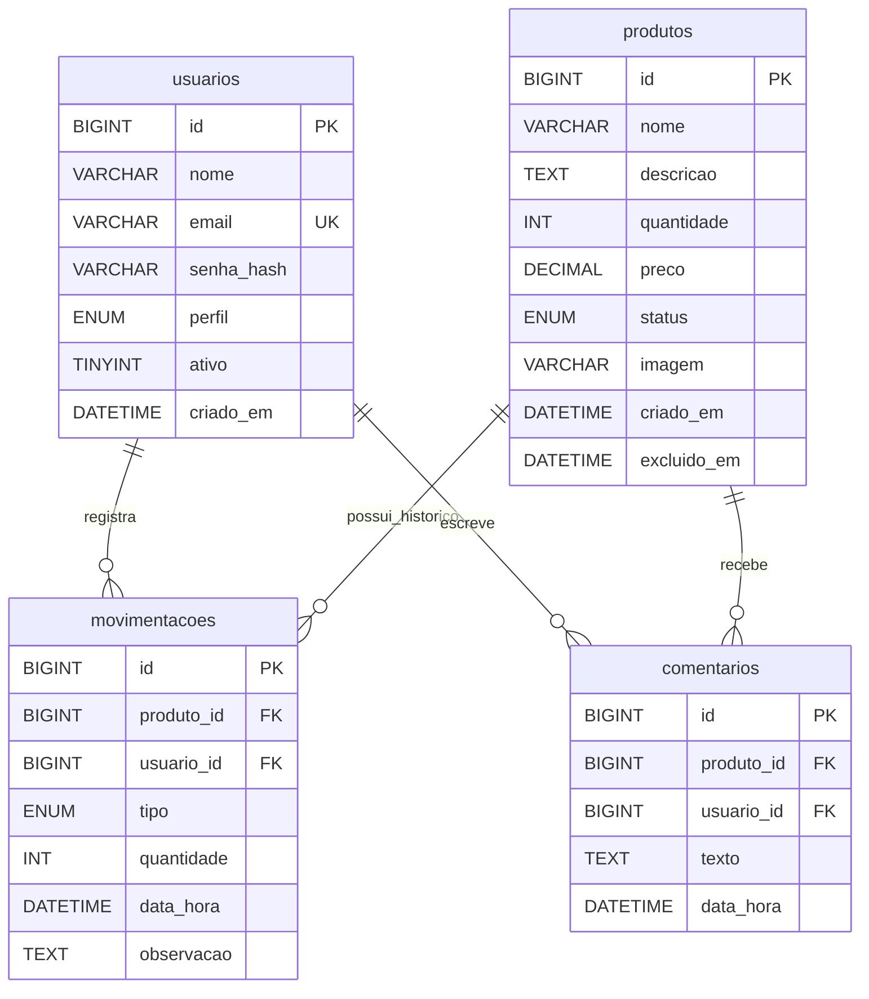

# DER/MER do StockControl

## Relacionamentos

- **usuarios 1:N movimentacoes** — cada movimento identifica um usuário responsável; cada usuário pode registrar vários movimentos.
- **produtos 1:N movimentacoes** — cada movimento pertence a um produto; cada produto pode ter vários movimentos.
- **usuarios 1:N comentarios** — cada comentário identifica seu autor; um usuário pode escrever vários comentários.
- **produtos 1:N comentarios** — cada comentário se refere a um produto; um produto pode receber vários comentários.

As chaves estrangeiras usam `ON DELETE RESTRICT` para preservar o histórico. A exclusão feita pela aplicação é lógica: define `status = inativo` e preenche `excluido_em`; o código impede a edição de um produto excluído. `imagem` pode ser nula nos exemplos iniciais, mas cadastro e edição exigem um arquivo de imagem.
